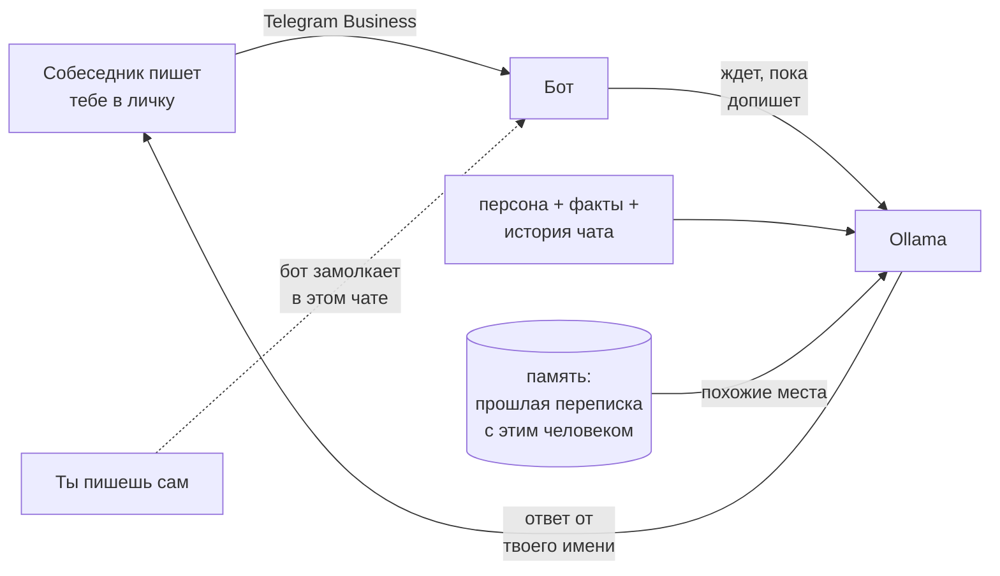

<div align="center">

# 🤖 Неунижайка

**Telegram-бот, который отвечает в личке за тебя — твоими словами.**

Подключается к аккаунту через Telegram Business, генерирует ответы локальной LLM в Ollama
и учится стилю на твоей собственной переписке.


</div>

> 📄 Как это сделано, по шагам и с ML-деталями: **[docs/REPORT.md](docs/REPORT.md)**

---

## Как это работает



- **Отвечает на серию, а не на каждое сообщение.** Ждет паузу в несколько секунд и отвечает на всё сразу,
  разбивая ответ на пару сообщений с индикатором «печатает…».
- **Уступает тебе.** Стоит написать в чат самому — бот замолкает там на полчаса, а твои сообщения
  попадают в его историю, чтобы потом продолжить по контексту.
- **Работает локально.** Модель крутится на твоем компьютере, переписка никуда не уходит.
- **Говорит как ты.** Стиль берется из экспорта твоих чатов: few-shot примерами в промпте или,
  лучше, дообучением модели (QLoRA) — см. [эксперименты](docs/experiments.md).
- **Помнит, а не выдумывает.** Перед ответом ищет похожие места в твоей прошлой переписке с этим человеком
  и видит файл фактов о тебе.

## Быстрый старт

<details open>
<summary><b>1. Ollama и модель</b></summary>

Установи [Ollama](https://ollama.com) и скачай модель. Без дообучения подойдет любая instruct-модель от 7–8B:

```bash
ollama pull qwen2.5:7b
```

> Не бери thinking-модели (например, тег `qwen3:30b-a3b`): они рассуждают перед каждым ответом по минуте.
> Нужна instruct-версия, например `qwen3:30b-a3b-instruct-2507-q4_K_M` — но ей нужно ~18 ГБ ОЗУ.
> Дообученная Qwen3-8B/14B (ниже) занимает 5–9 ГБ и пишет заметно больше похоже.

</details>

<details open>
<summary><b>2. Бот в BotFather</b></summary>

Создай бота в [@BotFather](https://t.me/BotFather), затем **Bot Settings → Secretary Mode** (раньше — Business Mode) → включить.

</details>

<details open>
<summary><b>3. Запуск</b></summary>

```bash
python -m venv .venv
.venv\Scripts\activate          # Linux/macOS: source .venv/bin/activate
pip install -r requirements.txt
copy .env.example .env          # Linux/macOS: cp .env.example .env
```

В `.env` обязательно: `TELEGRAM_TOKEN` и `OWNER_TELEGRAM_ID` (свой ID покажет `/whoami` у бота).
Без владельца бот не стартует — иначе к нему мог бы подключиться любой Premium-аккаунт.

```bash
python -m bot.main
```

</details>

<details open>
<summary><b>4. Проверка и подключение</b></summary>

1. Сначала проверь стиль в личке с самим ботом: просто пиши ему, `/reset` очищает историю.
   Или прогони набор типовых фраз: `python -m tools.try_persona`.
2. Подключи к аккаунту (нужен Telegram Premium): **Настройки → Telegram для бизнеса → Чат-боты** →
   выбери бота, дай право отвечать и выбери, в каких чатах ему можно работать.

</details>

## Учим стилю на своей переписке

### Датасет

Telegram Desktop → **Настройки → Продвинутые → Экспорт данных Telegram**: «Личные чаты», формат
**машиночитаемый JSON**, медиа не нужны.

```bash
python -m tools.prepare_dataset "путь/до/result.json"
```

| Флаг | Что делает |
|---|---|
| `--exclude-chat 123456` | не брать чат (по имени или ID, можно несколько раз) |
| `--gap-minutes 60` | пауза, после которой начинается новый диалог |
| `--max-dialogs-per-chat 500` | чтобы самые активные чаты не задавили остальные |
| `--min-reply-chars 15` | ответы короче — контекст без обучения (`"weight": 0`) |
| `--min-long-share 0.25` | выкинуть диалоги почти из одних «да / ок / понял» |
| `--system-file FILE` | системный промпт, с которым модель будет учиться |
| `--include-groups` | брать также группы |

На выходе в `data/`: `train.jsonl` и `val.jsonl` (диалоги для дообучения) и `examples.jsonl`
(пары «сообщение → ответ» для few-shot). Телефоны, почты, карты, ссылки и ники заменяются плейсхолдерами;
имена и адреса скрипт не ловит — просмотри датасет перед обучением.

### Вариант А: без обучения

Опиши себя в `data/persona.txt` (шаблон — [`data/persona.example.txt`](data/persona.example.txt)),
и бот подмешает в промпт `FEW_SHOT_EXAMPLES` пар из `examples.jsonl`. Быстро, но модель копирует
примеры и стиль получается «средний по больнице».

### Вариант Б: дообучение (рекомендуется)

```bash
python -m tools.prepare_dataset "путь/до/result.json" --out-dir data/finetune2 \
    --max-dialogs-per-chat 500 --min-reply-chars 15 --min-long-share 0.25 \
    --system-file data/persona.finetune.txt
```

`data/persona.finetune.txt` — одна-две фразы «кто ты и с кем переписываешься»
(шаблон — [`data/persona.finetune.example.txt`](data/persona.finetune.example.txt)).

Дальше — на GPU, одним из двух способов:

| | Где | Как |
|---|---|---|
| ☁️ | Google Colab | [`notebooks/finetune_colab_14b.ipynb`](notebooks/finetune_colab_14b.ipynb) → «Выполнить всё», загрузить `train.jsonl` и `val.jsonl` |
| 🖥️ | своя видеокарта NVIDIA | `python train/finetune.py --data data/finetune2 --out runs/14b` (установка — в начале [файла](train/finetune.py)) |

QLoRA на Qwen3-14B, 2 эпохи, чекпойнты каждые 100 шагов (прервалось — запусти заново, продолжит),
в конце берется чекпойнт с лучшим `eval_loss` и экспортируется GGUF q4_k_m (~9 ГБ).
Скрипт сам выбирает режим по видеопамяти: от 40 ГБ — LoRA поверх bf16 без квантования.

Готовый `.gguf` положи в `models/` и собери модель:

```bash
cd models
ollama create neunizhayka-14b -f Modelfile.14b
```

В `.env`:

```ini
OLLAMA_MODEL=neunizhayka-14b
PERSONA_FILE=data/persona.finetune.txt
FEW_SHOT_EXAMPLES=0
OLLAMA_TEMPERATURE=0.5
```

Дообученной модели лучше давать ровно тот системный промпт, на котором она училась: с дописками
(«отвечай развернуто, сочувствуй…», шаблон — [`data/persona.bot.example.txt`](data/persona.bot.example.txt))
14B сбивается в вежливый регистр и чаще отвечает невпопад — см. [эксперименты](docs/experiments.md).

## Память и факты

Дообученная модель знает твою манеру, но не твою жизнь — и выдумывает: «уже перевел», «я с ней расстался».
Для этого есть факты и поиск по переписке. **Оба пока работают хуже, чем хотелось**: дообученная модель
плохо переносит любой текст в промпте сверх того, на котором училась, — см. [эксперименты](docs/experiments.md).

**Факты** — `data/facts.txt` (шаблон — [`data/facts.example.txt`](data/facts.example.txt)): кто ты, где учишься,
что можно и нельзя обещать. Бот видит их всегда; строки с `#` — комментарии. Пиши только то, что не жалко
услышать любому собеседнику, и **коротко — 3–5 строк**: длинный список модель начинает пересказывать.

**Память** — поиск по прошлой переписке. Пары «реплика собеседника → твой ответ» индексируются эмбеддингами
`bge-m3`, и перед ответом бот подкладывает в промпт несколько самых похожих мест. **Выключено по умолчанию**
(`MEMORY_TOP_K=0`): дообученная модель копирует найденные ответы дословно, вплоть до «попозже переведу»
на просьбу о деньгах. Включать — `MEMORY_TOP_K=3`.

```bash
ollama pull bge-m3
python -m tools.build_memory "путь/до/result.json" --exclude-chat 123456
```

~30 тысяч фрагментов считаются около часа на ноутбуке; прервал — запусти снова, продолжит.
В Business-чатах бот ищет **только в переписке с этим же человеком**, чтобы не пересказывать одному то, что
писал другому; по всем чатам — только для тебя в личке с ботом. Сравнить с памятью и без:
`python -m tools.try_persona --show-memory` и `--no-memory`.

## Управление

| Команда в личке с ботом | |
|---|---|
| `/pause`, `/resume` | выключить / включить ответы во всех чатах |
| `/reset` | очистить историю тестового чата |
| `/whoami` | показать свой Telegram ID |
| `/auth <пароль>`, `/logout` | доступ к тестовому чату для других (если задан `BOT_ACCESS_PASSWORD`) |

<details>
<summary><b>Все настройки <code>.env</code></b></summary>

| Переменная | По умолчанию | |
|---|---|---|
| `TELEGRAM_TOKEN` | — | токен от BotFather |
| `TELEGRAM_PROXY_URL` | — | `socks5://…`, если Telegram заблокирован |
| `OWNER_TELEGRAM_ID` | — | твой ID; только этот аккаунт может подключить бота |
| `OLLAMA_URL` | `http://127.0.0.1:11434` | |
| `OLLAMA_MODEL` | `qwen2.5:7b` | |
| `OLLAMA_TEMPERATURE` | `0.8` | ниже — меньше бреда, выше — живее |
| `OLLAMA_KEEP_ALIVE` | `30m` | сколько держать модель в памяти после ответа |
| `OLLAMA_NUM_CTX` | `8192` | контекст модели |
| `PERSONA_FILE` | `data/persona.txt` | системный промпт |
| `EXAMPLES_FILE` | `data/examples.jsonl` | пары для few-shot |
| `FEW_SHOT_EXAMPLES` | `25` | сколько пар в промпт; `0` после дообучения |
| `HISTORY_LIMIT` | `20` | реплик истории на чат |
| `FACTS_FILE` | `data/facts.txt` | факты о тебе, бот видит всегда |
| `MEMORY_FILE` | `data/memory.sqlite` | индекс переписки от `tools.build_memory` |
| `EMBED_MODEL` | `bge-m3` | модель эмбеддингов для памяти |
| `MEMORY_TOP_K` | `0` | сколько фрагментов памяти в промпт (0 — память выключена) |
| `MEMORY_MIN_SCORE` | `0.65` | минимальная похожесть фрагмента (косинус) |
| `BOT_ACCESS_PASSWORD` | — | пароль к тестовому чату для других |
| `ALLOWED_TELEGRAM_USER_IDS` | — | кому можно в тестовый чат без пароля |
| `BUSINESS_IGNORE_CHAT_IDS` | — | собеседники, которым бот никогда не отвечает |
| `OWNER_TAKEOVER_MINUTES` | `30` | сколько молчать в чате, после того как ты написал сам |
| `REPLY_DEBOUNCE_SECONDS` | `8` | пауза после последнего сообщения собеседника |
| `SPLIT_REPLY_LINES` | `true` | каждая строка ответа — отдельным сообщением |
| `MAX_REPLY_MESSAGES` | `3` | максимум сообщений в одном ответе |
| `TYPING_SECONDS_PER_CHAR` | `0.05` | имитация набора |
| `TYPING_MAX_SECONDS` | `6` | |
| `REQUEST_TIMEOUT` | `180` | таймаут запроса к Ollama, с |

</details>

## Структура

```text
bot/
├── main.py              хендлеры Telegram и Business, debounce, takeover
├── ollama_client.py     запросы к Ollama: /api/chat и /api/embed
├── persona.py           системный промпт, few-shot, история чатов
├── memory.py            факты и поиск по прошлой переписке
├── formatters.py        нарезка ответа на сообщения
├── auth.py              доступ к тестовому чату
└── config.py            настройки из .env
tools/
├── prepare_dataset.py   экспорт Telegram → датасет
├── build_memory.py      экспорт Telegram → память бота (эмбеддинги)
└── try_persona.py       прогон типовых фраз через модель
train/finetune.py        дообучение на своей видеокарте
notebooks/               дообучение в Colab (8B и 14B)
models/                  Modelfile для сборки в Ollama
docs/REPORT.md           подробный технический отчет: данные, обучение, выводы
docs/experiments.md      хронология прогонов с примерами ответов
data/                    твои данные — в git попадают только шаблоны
```

## Приватность

Экспорт, датасеты, персоны, факты, память, `.env` и веса моделей в `.gitignore` — в репозиторий уходят только
код и шаблоны. `data/memory.sqlite` содержит твою переписку открытым текстом — обращайся с ним как с экспортом.
Дообученная модель запоминает куски переписки, поэтому **не публикуй GGUF** и не давай доступ к боту посторонним.

## Ограничения

- видит только текст и подписи к медиа, стикеры и голосовые пропускает;
- может выдумывать факты — память и `facts.txt` это сильно снижают, но не до нуля;
- Business-боты работают только в личных чатах, не в группах;
- история хранится в памяти процесса и сбрасывается при перезапуске.

## Лицензия

Код — [MIT](LICENSE). Веса дообученных моделей в репозиторий не входят и публиковаться не должны (см. «Приватность»).
