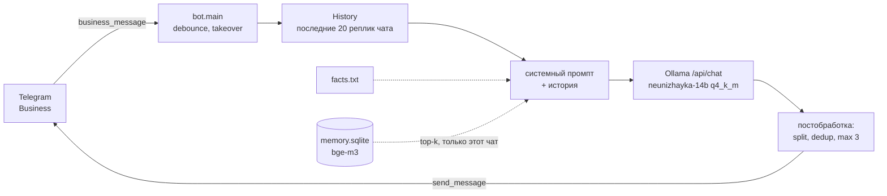

# Неунижайка: дообучение LLM под стиль переписки конкретного человека

Технический отчет о проекте целиком: от экспорта переписки до бота, который отвечает в Telegram от имени владельца
аккаунта. Цель документа — чтобы специалист (или автор через полгода) мог понять каждое решение и воспроизвести
результат. Короткая хронология прогонов с примерами ответов — в [experiments.md](experiments.md).

## Содержание

1. [Итог в двух абзацах](#1-итог-в-двух-абзацах)
2. [Постановка задачи](#2-постановка-задачи)
3. [Архитектура системы](#3-архитектура-системы)
4. [Данные](#4-данные)
5. [Базовая линия: промптинг без обучения](#5-базовая-линия-промптинг-без-обучения)
6. [Fine-tune v1: Qwen3-8B, QLoRA](#6-fine-tune-v1-qwen3-8b-qlora)
7. [Fine-tune v2: Qwen3-14B, маскирование коротких ответов](#7-fine-tune-v2-qwen3-14b-маскирование-коротких-ответов)
8. [Экспорт и инференс: GGUF и Ollama](#8-экспорт-и-инференс-gguf-и-ollama)
9. [Чувствительность к системному промпту](#9-чувствительность-к-системному-промпту)
10. [Эксперимент с RAG и фактами](#10-эксперимент-с-rag-и-фактами)
11. [Оценка качества и ее ограничения](#11-оценка-качества-и-ее-ограничения)
12. [Инфраструктурные грабли](#12-инфраструктурные-грабли)
13. [Воспроизведение](#13-воспроизведение)
14. [Приватность и этика](#14-приватность-и-этика)
15. [Что дальше](#15-что-дальше)

---

## 1. Итог в двух абзацах

Лучший результат — **Qwen3-14B, дообученная QLoRA на ~4 тыс. диалогов владельца** (2 эпохи, лосс только по ответам
владельца длиной от 15 символов), экспортированная в GGUF q4_k_m (9 ГБ) и запущенная в Ollama на ноутбуке
с RTX 3050 4 ГБ (≈78% слоев на CPU, медиана ответа ~6 с). Модель уверенно воспроизводит лексику, длину
сообщений, разбиение мысли на несколько сообщений, реакцию на наезды и подколы; на личные вопросы отвечает
уклончиво («это личное»). Лучший `eval_loss` на отложенной выборке — **≈2.61** (перплексия ≈13.6 по токенам ответов).

Главная нерешенная проблема — **конфабуляция фактов** («уже перевел», выдуманные планы и люди): модель знает
манеру, но не жизнь владельца. Попытки добавить знания через промпт (факты, RAG по переписке) на дообученной модели
**ухудшили** стиль: модель плохо переносит любой текст в системном промпте, которого не было при обучении,
и копирует найденные фрагменты дословно. Правильное направление — обучать модель сразу с этим контекстом
(RAG-aware fine-tuning, раздел 15).

## 2. Постановка задачи

- **Вход:** серия сообщений собеседника в личном чате + последние N реплик этого чата.
- **Выход:** 1–3 коротких сообщения, неотличимых по стилю от владельца аккаунта и уместных по смыслу.
- **Ограничения:** все локально (переписка не уходит в облачные API); инференс на потребительском ноутбуке;
  бот не должен брать на себя обязательства (деньги, встречи) и признаваться, что он бот.
- **Доставка:** Telegram Business (в BotFather — *Secretary Mode*): бот получает апдейты `business_message`
  из чатов владельца и отвечает от его имени через `business_connection_id`.

С точки зрения ML это **условная генерация реплики в диалоге с переносом стиля конкретного автора**
(persona / author-style imitation). Стиль — это распределение по лексике, длине, пунктуации, темпу
и прагматике ответов; его надежнее всего вшивать в веса через SFT на реальных ответах автора.

## 3. Архитектура системы



Поведение поверх модели:

- **Debounce.** Ответ откладывается на 8 с после последнего сообщения собеседника; новое сообщение перезапускает
  таймер. Люди пишут сериями, и ответ на каждое сообщение отдельно выглядит неестественно.
- **Owner takeover.** Если владелец сам пишет в чат, его сообщение попадает в историю как `assistant`,
  а бот замолкает в этом чате на 30 минут.
- **Постобработка.** Ответ режется по строкам на отдельные сообщения (так устроены данные — см. 4.3),
  удаляются строки, которые бот уже писал в этом чате (нормализованное сравнение, только для строк > 12 символов),
  `ё → е`, не больше 3 сообщений; перед каждым — `typing` с задержкой ∝ длине.
- **Безопасность подключения.** Business-подключение принимается только от `OWNER_TELEGRAM_ID`: иначе любой
  Premium-пользователь мог бы подключить бота к своему аккаунту и пользоваться чужой LLM.

## 4. Данные

### 4.1. Источник

Экспорт Telegram Desktop в машиночитаемом JSON (`result.json`, ~170 МБ), только личные чаты, без медиа.
В экспорте не было блока `personal_information`, поэтому ID владельца определяется эвристикой: это отправитель,
который присутствует в большинстве личных чатов (`guess_my_id`). Один чат исключен по просьбе владельца
(`--exclude-chat`), чаты, где владелец написал меньше 20 сообщений, пропускаются.

### 4.2. Сегментация

Сырая переписка — это бесконечный поток; для SFT нужны конечные диалоги, похожие на то, что модель увидит в проде.

1. **Сессии.** Чат режется на сессии по паузе > 60 минут (`--gap-minutes`): после долгой паузы начинается
   новый разговор, и контекст старого только мешает.
2. **Склейка реплик.** Подряд идущие сообщения одного автора склеиваются через `\n` в одну реплику (turn).
   Так диалог становится строго чередующимся `user/assistant`, как в чат-шаблоне, а перенос строки внутри
   ответа модель учится использовать как разделитель сообщений — бот потом режет ответ по `\n`.
3. **Окна.** Длинные сессии делятся на непересекающиеся окна до 16 реплик; окно всегда начинается с реплики
   собеседника и заканчивается репликой владельца (хвостовая реплика собеседника отбрасывается — на нее нет таргета).
4. **Пересланные сообщения** выбрасываются (это не речь автора), ответы длиннее 1000 символов — тоже
   (почти всегда копипаста).

### 4.3. Очистка и анонимизация

- Телефоны, почты, номера карт, ссылки и `@`-упоминания заменяются плейсхолдерами `<телефон>`, `<email>`,
  `<карта>`, `<ссылка>`, `<ник>`: сначала по разметке Telegram (`text_entities`), затем регулярками.
  **Имена и адреса не ловятся** — это сознательное ограничение, датасет нужно просматривать глазами.
- **Асимметрия медиа.** У собеседника стикеры, голосовые, фото заменяются на `[стикер]`, `[голосовое]` и т. п.
  — модель должна понимать, что ей что-то прислали. У владельца строки, состоящие только из плейсхолдеров,
  удаляются: бот не умеет слать стикеры, а без этой чистки модель отвечала буквально `<ссылка>` (484 таких ответа
  в первой версии датасета).

### 4.4. Балансировка и сплит

Распределение диалогов по чатам сильно скошено: несколько активных чатов дают большую часть данных, и модель
переняла бы стиль общения именно с этими людьми. Поэтому — лимит **500 диалогов на чат** (`--max-dialogs-per-chat`,
случайная подвыборка). Сплит train/val — 95/5 **на уровне диалогов**. Поскольку окна из одного чата попадают
в обе части, `eval_loss` оптимистичен (стиль конкретного собеседника «протекает»); для честной оценки обобщения
нужен сплит по чатам.

Формат — ShareGPT/OpenAI-совместимый JSONL, по диалогу на строку:

```json
{"messages": [
  {"role": "system", "content": "Ты — <имя>, переписываешься в Telegram от своего имени..."},
  {"role": "user", "content": "го в субботу на шашлыки"},
  {"role": "assistant", "content": "да", "weight": 0},
  {"role": "user", "content": "ну так во сколько"},
  {"role": "assistant", "content": "давай к трем\nя только после пар"}
]}
```

`"weight": 0` — пометка для маскирования лосса (раздел 7), тот же ключ, что в формате fine-tune OpenAI.

### 4.5. Статистика

| | v1 (`data/finetune`) | v2 (`data/finetune2`) |
|---|---|---|
| Диалогов train / val | 4 541 / 239 | 4 067 / 214 |
| Ответов владельца | 22 883 | 22 652 |
| Из них в лоссе | все | 17 565 (78%) |
| Токенов (Qwen3) всего / в лоссе | ~1.1 млн / — | 1.52 млн / 539 тыс. (35%) |

Длина ответа владельца: медиана 31 символ, среднее 57, в среднем 2.6 строки (= сообщения).

| Длина ответа | Доля |
|---|---|
| < 5 символов | 5.8% |
| 5–10 | 10.2% |
| 10–15 | 9.7% |
| 15–30 | 22.4% |
| 30–60 | 24.5% |
| 60–120 | 17.0% |
| ≥ 120 | 10.4% |

Самые частые ответы: «да» (171), «ок» (60), «хорошо» (40), «оке», «?», «понял», «нет», «окс», «неа», «ага».
Четверть ответов короче 15 символов — это объясняет склонность v1 к односложным ответам (раздел 7).

## 5. Базовая линия: промптинг без обучения

Прежде чем учить, стоило проверить потолок промптинга.

**Модели.** Сначала `qwen3:30b-a3b` — MoE (30B параметров, ~3B активных на токен), которая влезает в 32 ГБ ОЗУ
и дает ~16 ток/с на CPU. Выяснилось, что этот тег в Ollama — **Thinking-2507**: модель генерирует рассуждение
перед каждым ответом (70–120 с) и игнорирует `/no_think` и `think: false`. Заменена на
`qwen3:30b-a3b-instruct-2507-q4_K_M` (медиана ответа 1.9 с). Вывод: у Qwen3-2507 thinking и instruct — разные
чекпойнты, а не режимы одной модели.

**Промпт.** Персона (кто ты, как пишешь, чего нельзя) + 40 few-shot пар «реплика → ответ» из датасета,
отобранных эвристикой: реплика 15–200 символов и содержит вопрос или ≥ 4 слов, ответ 6–160 символов из ≥ 2 слов,
без плейсхолдеров. Промпт собирается один раз на запуск (`lru_cache`), чтобы Ollama переиспользовала
KV-кэш общего префикса.

**Что выяснилось:**

- **Модель копирует few-shot дословно** и продолжает их как текущий диалог («я просто в шоке от твоего кайфа»
  в каждом третьем ответе). Помогло: примеры — в начало промпта с явной пометкой «это не текущий разговор,
  не продолжай», инструкции — в конец, ближе к диалогу (recency bias).
- **Описание интересов порождает стереотип.** Строчка про профессиональные увлечения превратилась в «кручу
  пентесты» в ответ на «че делаешь». Подробные описания личности работают как тема для разговора, а не как фон.
- Итог: разговорно и по теме, но **стиль усредненный** («пацанский» вообще, а не этого человека), выдуманные
  факты, смех над плохими новостями. 18 ГБ модели на 32 ГБ ОЗУ — бот падал по памяти.

Это потолок in-context learning: несколько десятков примеров не передают распределение по 22 тыс. ответов.

## 6. Fine-tune v1: Qwen3-8B, QLoRA

### 6.1. Метод

**QLoRA** (Dettmers et al., 2023): базовая модель заморожена и загружена в 4 бита (NF4, двойное квантование),
обучаются только **LoRA-адаптеры** (Hu et al., 2021) — для весовой матрицы `W ∈ R^{d×k}` добавляется
низкоранговая поправка `ΔW = (α/r)·B·A`, `B ∈ R^{d×r}`, `A ∈ R^{r×k}`, `r ≪ min(d, k)`. Градиенты идут через
деквантованные веса в bf16/fp16, оптимизируются только `A` и `B` (~1% параметров). Это позволяет учить
8–14B модели на 15–16 ГБ видеопамяти.

Реализация — **Unsloth** (собственные Triton-ядра для LoRA, RoPE, cross-entropy и gradient checkpointing;
≈2× быстрее и меньше памяти, чем ванильный PEFT).

### 6.2. Гиперпараметры

| Параметр | Значение | Почему |
|---|---|---|
| База | `unsloth/Qwen3-8B-unsloth-bnb-4bit` | лучший русский среди открытых моделей этого размера на момент работы |
| LoRA `r` / `α` / dropout | 32 / 32 / 0 | `α/r = 1`; ранг с запасом для стиля, dropout 0 — рекомендация Unsloth |
| Target modules | `q,k,v,o,gate,up,down_proj` | все линейные слои attention и MLP: стиль живет не только в attention |
| `max_seq_length` | 2048 | окна по 16 реплик почти всегда влезают |
| Батч | 2 × grad accum 4 = 8 | |
| Эпохи | 1 | |
| LR / scheduler / warmup | 2e-4 / cosine / 20 шагов | стандарт для QLoRA |
| Оптимизатор | `adamw_8bit`, weight decay 0.01 | экономия памяти на состояниях оптимизатора |
| Gradient checkpointing | `"unsloth"` | |
| Где | Google Colab, GPU-рантайм | |

### 6.3. Чат-шаблон и маскирование

Диалоги рендерятся родным шаблоном Qwen3 (ChatML) с `enable_thinking=False`. Важная деталь шаблона: в последнюю
реплику ассистента подставляется пустой блок рассуждений `<think>\n\n</think>\n\n`, в предыдущие — нет. Тот же
префикс должен стоять в инференсе (раздел 8), иначе модель окажется в непривычном распределении.

Лосс считается **только по токенам ответов владельца** (`train_on_responses_only`): реплики собеседника
и системный промпт — контекст с `labels = -100`. Без этого модель тратила бы емкость на то, чтобы научиться
писать за собеседников.

### 6.4. Результат

Манера и лексика заметно ближе к владельцу, чем при промптинге; ответ ~3 с на ноутбуке (GGUF 5 ГБ).
Но **много односложных ответов** («Хз», «Да», «Ебать да») и бессвязных цепочек; на больного кота — «Вхахазаха /
Классик». Попытка лечить промптом («пиши законченными репликами, сочувствуй») помогла частично и сломала
регистр (раздел 9).

## 7. Fine-tune v2: Qwen3-14B, маскирование коротких ответов

### 7.1. Диагноз

Две гипотезы: (1) модель учится воспроизводить частые короткие ответы — 26% таргетов короче 15 символов,
а «да/ок/понял» уместны только в контексте, который модель понимает хуже человека; (2) 8B и одной эпохи мало
для связности. Проверяем обе сразу.

### 7.2. Изменения

**Пер-репличное маскирование.** Ответы короче 15 символов остаются в диалоге как контекст, но исключаются
из лосса (`"weight": 0`). Модель видит, что владелец иногда отвечает «да», но градиент от этих ответов не идет.
Это лучше, чем выбрасывать короткие реплики: тогда ломались бы диалоги и модель не видела бы реального ритма.
Дополнительно выброшены диалоги, где длинных ответов меньше 25% (`--min-long-share 0.25`): в них почти нечему учиться.

`train_on_responses_only` такое не умеет (маскирует по ролям, а не по репликам), поэтому токенизация своя:

```python
text = tokenizer.apply_chat_template(messages, tokenize=False, enable_thinking=False)
# символьные интервалы обучаемых ответов: от "<|im_start|>assistant\n" до "<|im_end|>" включительно
spans = [(start, end) for each assistant turn with weight != 0]
enc = tokenizer(text, return_offsets_mapping=True, truncation=True, max_length=2048)
labels = [tok if any(a < e and b > s for s, e in spans) else -100
          for tok, (a, b) in zip(enc.input_ids, enc.offset_mapping)]
```

Токен попадает в лосс, если его символьный интервал пересекается с обучаемым ответом. В лосс входит и `<|im_end|>`
— модель учится вовремя останавливаться. Маска проверена на настоящем токенизаторе Qwen3: декодированные
обучаемые куски совпали с ожидаемыми ответами во всех 214 диалогах валидации. 4 диалога train отпали:
после обрезки до 2048 токенов в них не осталось обучаемых ответов.

Обучение — через обычный `transformers.Trainer` с `DataCollatorForSeq2Seq(label_pad_token_id=-100)`:
`SFTTrainer` из TRL в разных версиях по-разному обращается с готовыми `labels` (может пересобрать их сам).

**Больше модель, больше эпох.** Qwen3-14B, 2 эпохи; LR снижен до 1e-4 (больше модель и больше проходов —
меньше шаг, чтобы не переобучиться), warmup 3% шагов.

| Параметр | v1 | v2 |
|---|---|---|
| База | Qwen3-8B 4bit | Qwen3-14B 4bit |
| Лосс | все ответы | ответы ≥ 15 символов |
| Эпохи | 1 | 2 (~1000 шагов) |
| LR | 2e-4 | 1e-4 |
| Батч | 2 × 4 | 1 × 8 |
| Warmup | 20 шагов | 3% шагов |
| Eval / save | каждые 100 шагов | каждые 100 шагов, `load_best_model_at_end` по `eval_loss` |
| Железо | Colab GPU | RTX A4000 16 ГБ (Windows), ~5 ч |

`load_best_model_at_end=True` + `save_total_limit=2`: если на второй эпохе начнется переобучение
(`eval_loss` растет при падающем `train_loss`), в конце загружается лучший чекпойнт, а не последний.
Чекпойнты пишутся на диск каждые 100 шагов, и повторный запуск продолжает с последнего (`resume_from_checkpoint`).

### 7.3. Результат

Лучший `eval_loss` ≈ **2.61** (средняя кросс-энтропия на токен ответа, натуральный логарифм; перплексия
`e^2.61 ≈ 13.6`). Для разговорного русского с матом, опечатками и высокой энтропией ответов это ожидаемый
порядок; сравнивать с v1 напрямую нельзя — у v1 другая модель и другой набор токенов в лоссе.

Качественно (см. experiments.md, раздел 4) — связнее 8B, хорошо держит конфликт («Все все / Не кипятись брат /
Я понял»), личные темы («Это личное / Не хочу обсуждать»), уместное сочувствие. Осталась конфабуляция фактов.

## 8. Экспорт и инференс: GGUF и Ollama

**Экспорт** (`model.save_pretrained_gguf(..., quantization_method="q4_k_m")` в Unsloth):

1. LoRA сливается с **оригинальными 16-битными весами** (Unsloth докачивает их, ~30 ГБ, а не деквантует 4-битную
   базу — так точнее).
2. Слитая модель конвертируется `convert_hf_to_gguf.py` в GGUF bf16 (~30 ГБ).
3. `llama-quantize` → **q4_k_m** (k-quants, смешанная 4/6-битная точность по блокам; 9.0 ГБ для 14B).

Пиковое место на диске — **~57.5 ГБ** (слияние и промежуточный bf16 лежат одновременно), из них ~30 ГБ —
в текущей рабочей директории процесса, а не в папке экспорта (раздел 12).

**Ollama Modelfile** повторяет шаблон обучения байт в байт, включая пустой блок рассуждений в начале ответа:

```
FROM ./neunizhayka-14b-q4_k_m.gguf
TEMPLATE """{{- range .Messages }}<|im_start|>{{ .Role }}
{{ .Content }}<|im_end|>
{{ end }}<|im_start|>assistant
<think>

</think>

"""
PARAMETER stop "<|im_end|>"
PARAMETER stop "<|im_start|>"
```

**Декодирование:** temperature 0.5, top_p 0.9, repeat_penalty 1.1, `num_ctx` 8192. Температура подбиралась
вручную: 0.7 давала больше бессвязных ответов, ниже 0.5 — однообразие.

**Инференс на ноутбуке** (RTX 3050 Laptop 4 ГБ, 32 ГБ ОЗУ): Ollama кладет на GPU ~22% слоев 14B, остальное —
на CPU. Медиана ответа ~6 с без дополнительного контекста в промпте; первый ответ после простоя — до 15–30 с
(загрузка модели). Для переписки это приемлемо: debounce все равно ждет 8 с.

## 9. Чувствительность к системному промпту

Самое неочевидное наблюдение проекта. Модель училась с коротким системным промптом из трех предложений
(`persona.finetune.txt`: кто ты, отвечай по смыслу в своей манере, не выдумывай и не обещай). На инференсе сравнивались:

| Системный промпт | Эффект на 14B |
|---|---|
| Ровно тот, что в обучении | лучший стиль и связность |
| Тот же + абзац «отвечай законченными репликами, сочувствуй, не выдумывай» | «Добрый день!», вежливый регистр, больше бессмыслицы |
| Тот же + 20 строк фактов о владельце | пересказ фактов («Я <имя>, студент…»), регистр ассистента («Я всегда рад помочь!») |
| Тот же + фрагменты переписки (RAG) | дословное копирование фрагментов |

Интерпретация: SFT сузил распределение — при «своем» промпте модель в режиме «владелец в чате»,
а длинные инструкции в системном промпте — признак режима ассистента из instruct-обучения базы, и модель
частично в него возвращается. **Практическое правило: дообученной модели давать ровно тот системный промпт,
на котором она училась; все, что нужно на инференсе, — добавлять в промпт уже при обучении.**

## 10. Эксперимент с RAG и фактами

**Идея.** Модель выдумывает факты, потому что не знает их. Дать ей (а) короткий файл фактов о владельце
и (б) похожие места из прошлой переписки с этим же человеком.

**Индекс** (`tools/build_memory.py`): 30 506 пар «реплика собеседника → ответ владельца» (пары короче
40 символов суммарно отброшены, каждая реплика обрезана до 300 символов), к каждой — месяц и год, чтобы модель
не путала давнее с сегодняшним. Эмбеддинги **bge-m3** (мультиязычная, 1024-мерная) через Ollama `/api/embed`,
L2-нормализация, хранение в SQLite (`float32` blob), поиск — полный перебор `X @ q` в numpy
(30 тыс. × 1024 — 120 МБ, миллисекунды; ANN-индекс не нужен). Индексация — ~40 мин на ноутбуке.

**Приватность поиска.** ID личного чата в экспорте совпадает с ID собеседника, который приходит в Business
как `chat_id` (проверено: 82/82 чата). В Business-чатах поиск идет **только по переписке с этим же человеком** —
иначе бот пересказывал бы одному то, что писал другому. По всем чатам — только для владельца в тестовом чате.

**Калибровка.** На коротких разговорных запросах косинусная близость bge-m3 почти для всего лежит в 0.55–0.71:
плохое разделение релевантного и шума. По ручной разметке топ-3 для 23 тестовых фраз порог выставлен на 0.65,
top-k = 3, запросы короче 12 символов не ищутся.

**Латентность.** Медиана ответа выросла с 6 до 24 с. Причина — не длина промпта: модель эмбеддингов, загружаясь
на ту же GPU 4 ГБ, вытесняла 14B, и та грузилась заново перед каждым ответом. Решение — считать эмбеддинги
на CPU (`options.num_gpu = 0`): поиск 0.2–0.4 с.

**Результат — отрицательный:**

- Модель **копирует найденные ответы дословно**: на «скинь 500 до пятницы» — «Сап / Попозже переведу»,
  реальный ответ трехлетней давности, перебивший правило из фактов.
- Короткие факты помогают в узких случаях (деньги, планы — модель отвечает дословно заготовленной фразой),
  длинные — модель пересказывает и уходит в регистр ассистента (раздел 9).

Поиск выключен по умолчанию (`MEMORY_TOP_K=0`), факты сокращены до 4 строк. Инфраструктура оставлена:
она пригодится для RAG-aware дообучения (раздел 15).

## 11. Оценка качества и ее ограничения

Оценка в проекте — **качественная**: фиксированный набор из 13 диалогов / 23 реплик (`tools/try_persona.py`),
покрывающий бытовуху, приглашения, просьбы о деньгах, плохие новости, наезды, вопрос «ты бот?», упоминание
незнакомого человека, технический вопрос. Каждый ответ проходит ту же постобработку, что в боте; ответы
с подозрительными паттернами (признание в том, что бот, техно-стереотип) помечаются.

Ограничения, которые нужно держать в голове:

- **Один сэмпл при T = 0.5** на реплику — дисперсия большая, сравнение двух прогонов «на глаз» ненадежно.
- **Нет автоматических метрик стиля.** `eval_loss` меряет правдоподобие реальных ответов, а не уместность
  сгенерированных.
- **Сплит не по чатам** — `eval_loss` оптимистичен (раздел 4.4).
- Тестовые фразы написаны одним человеком.

Что стоило бы сделать для честной оценки: (1) `eval_loss` по held-out чатам; (2) слепой парный тест — друзьям
показывают реальный ответ и ответ модели на одну и ту же реплику, доля неугаданных — прямая метрика задачи;
(3) LLM-as-a-judge на уместность и на запрещенные классы (обещания денег, выдуманные факты) по 5–10 сэмплам на реплику.

## 12. Инфраструктурные грабли

Половина времени ушла не на ML. Для повторения пригодится:

| Симптом | Причина | Решение |
|---|---|---|
| Ответ 70–120 с, рассуждения в выводе | тег `qwen3:30b-a3b` — thinking-модель | брать `*-instruct-2507` |
| Colab TPU v5e не подходит | Unsloth и bitsandbytes — только CUDA | GPU-рантайм |
| `TrainingArguments got an unexpected keyword 'warmup_ratio'` | убран в transformers 5 | считать `warmup_steps` вручную; фильтровать kwargs по сигнатуре |
| `KeyError: 'weight'` в `datasets.map` | новые `datasets` не заполняют отсутствующие ключи `None` | `m.get("weight")` |
| `Activate.ps1` запрещен | Execution Policy в PowerShell | `Set-ExecutionPolicy -Scope Process Bypass` или вызывать `.venv\Scripts\python.exe` напрямую |
| `activate.bat` из PowerShell «не работает» | выполняется в дочернем `cmd` и умирает с ним | см. выше |
| Драйвер 462.96 / CUDA 11.2 | сборки torch `cu128` требуют драйвер ≥ 528 | обновить драйвер (RTX/Quadro, чистая установка) |
| Драйвер не ставится | групповая политика `DeviceInstall\Restrictions` | проверить классы устройств; с разрешения админа |
| Unsloth: «torch установлен как CPU» | `pip install unsloth` тянет CPU-колесо torch с PyPI | переустановить ту же версию с индекса `cu128` с `--no-deps` |
| Предупреждение про symlinks HF | Windows без Developer Mode | безвредно, `HF_HUB_DISABLE_SYMLINKS_WARNING=1` |
| `Not enough disk space to convert to GGUF` (57.5 ГБ) | слияние + bf16 GGUF + квант одновременно | вывод на большой диск |
| То же, «29.7 ГБ в current working directory» | промежуточный bf16 пишется в CWD | `os.chdir()` на большой диск перед экспортом; `HF_HOME` и `TEMP` туда же |
| Готовый llama.cpp не распаковался, затем требует CMake | путь в архиве > 260 символов (MAX_PATH) | `LongPathsEnabled=1` в реестре; новый процесс |
| Новые программы «не видны» | процесс унаследовал старый `PATH` | открыть новый терминал |
| Экспорт качает еще ~30 ГБ | слияние идет с оригинальными 16-битными весами | закладывать время и место |
| Бот убит при простое | ОС не хватало памяти (модель 18 ГБ на 32 ГБ ОЗУ) | модель меньше / отдельный процесс |
| Ответы 24 с вместо 6 после добавления RAG | модель эмбеддингов вытесняла основную из 4 ГБ VRAM | эмбеддинги на CPU (`num_gpu: 0`) |
| `ollama create` не читает Modelfile | BOM в UTF-8 от PowerShell `Set-Content` | писать без BOM |

## 13. Воспроизведение

Версии, на которых все работало:

| Компонент | Версия |
|---|---|
| Python | 3.12 |
| Unsloth | 2026.10.8 |
| Transformers | 5.17.0 |
| PyTorch | 2.11.0+cu128 |
| Triton | 3.8.0 (triton-windows) |
| llama.cpp (через Unsloth) | b11876 |
| Ollama | 0.40.11 |
| python-telegram-bot | 22.8 |

Шаги:

```bash
# 1. Датасет из экспорта Telegram (JSON)
python -m tools.prepare_dataset "result.json" --out-dir data/finetune2 \
    --max-dialogs-per-chat 500 --min-reply-chars 15 --min-long-share 0.25 \
    --system-file data/persona.finetune.txt --exclude-chat <id>

# 2. Обучение на своей GPU (или notebooks/finetune_colab_14b.ipynb в Colab)
python train/finetune.py --data data/finetune2 --out runs/14b
#    упал экспорт — повторить только его:
python train/finetune.py --data data/finetune2 --out runs/14b --export-only

# 3. Сборка в Ollama
cp runs/14b/neunizhayka-14b-q4_k_m.gguf models/
cd models && ollama create neunizhayka-14b -f Modelfile.14b

# 4. Проверка и запуск
python -m tools.try_persona
python -m bot.main
```

`.env` для v2: `OLLAMA_MODEL=neunizhayka-14b`, `PERSONA_FILE=data/persona.finetune.txt`, `FEW_SHOT_EXAMPLES=0`,
`OLLAMA_TEMPERATURE=0.5`. Все параметры — в README.

Требования к железу для обучения 14B в 4 битах: ≥ 16 ГБ VRAM, ~15 ГБ на модель и кэш, **~60 ГБ свободного места
на одном диске** для экспорта плюс ~30 ГБ на 16-битные веса в кэше HF.

## 14. Приватность и этика

- **Меморизация.** Дообученная модель воспроизводит фрагменты обучающей переписки — в том числе сообщения
  собеседников, которые на это не соглашались. LoRA-адаптер и GGUF содержат эти данные в весах:
  **их нельзя публиковать**. В репозитории — только код и шаблоны; экспорт, датасеты, персоны, факты,
  `memory.sqlite`, `.env` и веса — в `.gitignore`.
- **Анонимизация неполная**: контакты и ссылки заменяются, имена и адреса — нет.
- **Обман собеседника.** Бот пишет от имени человека и запрещено ему признаваться. Это нормально для шутки
  между друзьями, но если разговор уходит в личное или серьезное, стоит перехватить его (owner takeover) или
  признаться, пока человек не рассказал боту то, что предназначал владельцу.
- **Конфабуляция с последствиями.** Бот может «пообещать» деньги или встречу. Факты и правила снижают риск,
  но не до нуля; для реального использования нужен фильтр на классы обязательств с передачей диалога человеку.

## 15. Что дальше

По ожидаемой пользе:

1. **RAG-aware fine-tuning.** Собрать датасет, где в системном промпте уже есть факты и top-k фрагментов из
   *других* сессий того же чата (найденные тем же поиском), и дообучить. Модель научится использовать контекст,
   а не копировать его и не пересказывать, — это закрывает обе проблемы раздела 10.
2. **Кондиционирование на собеседника.** Добавить в системный промпт роль собеседника («близкий друг»,
   «одногруппник», «родственник»): стиль владельца сильно зависит от адресата, а сейчас модель учится на смеси.
3. **DPO на собственных оценках.** Кнопки 👍/👎 и «как бы ответил я» в тестовом чате → пары предпочтений →
   DPO поверх SFT-адаптера (Unsloth поддерживает). Хорошо бьет по конкретным нежелательным паттернам
   (зацикливание на теме, обещания).
4. **Честная оценка** — раздел 11.
5. **Мелочи продукта:** персистентная история (SQLite), расшифровка голосовых (faster-whisper на CPU),
   режим секретаря (деньги/встречи/«срочно» → уведомление владельцу вместо ответа).
